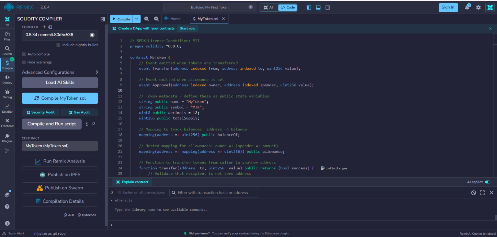
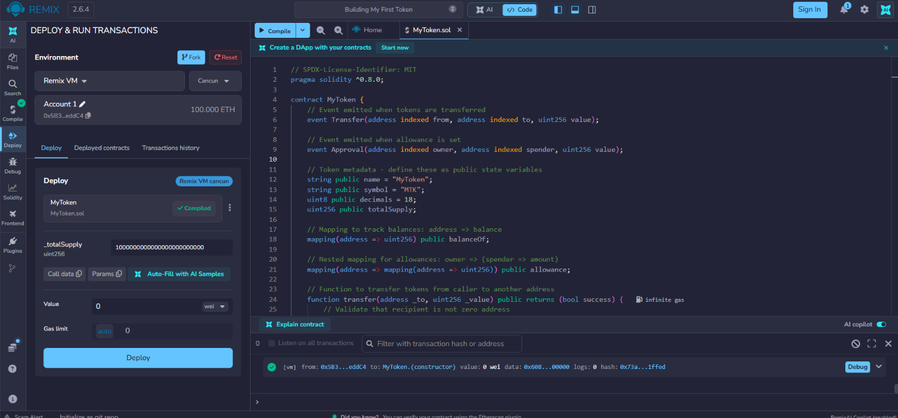
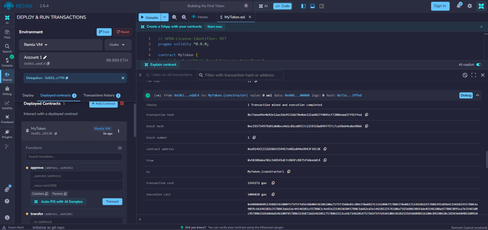
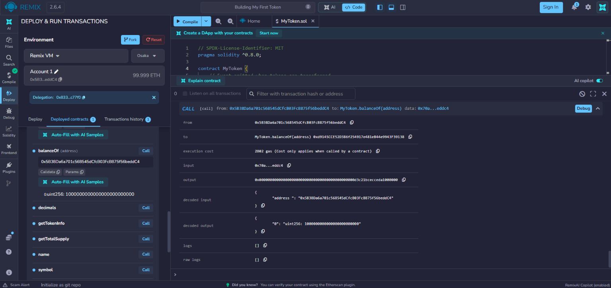
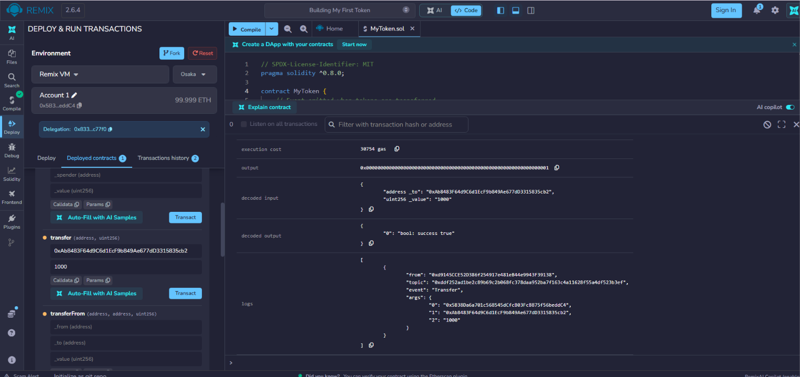
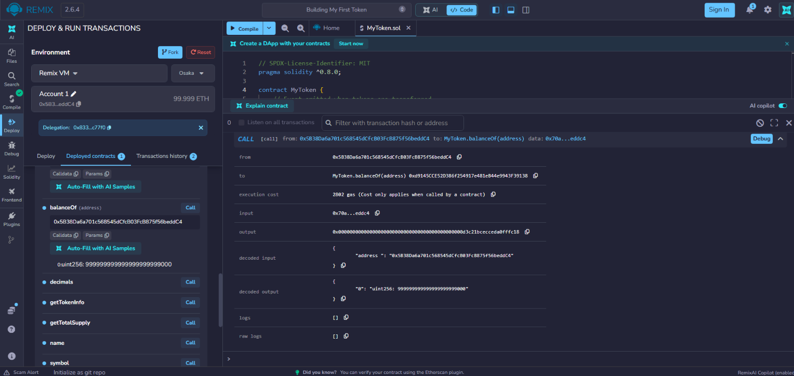
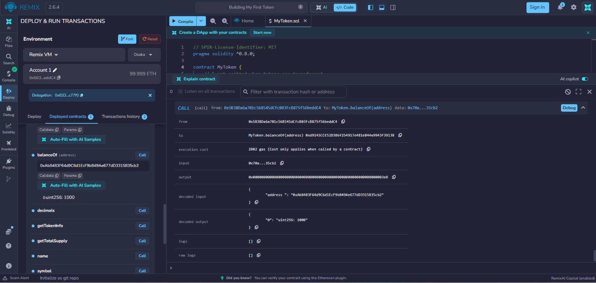
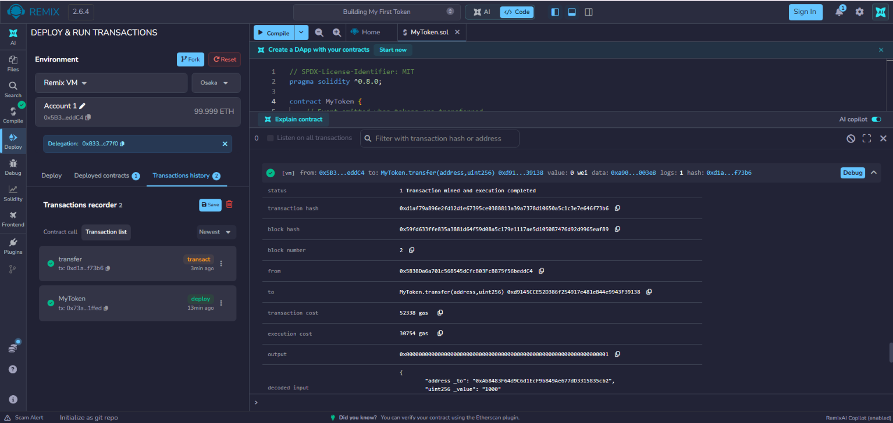

# My Learning Reflections

## What I Learned

Building this ERC-20 token was an incredibly eye-opening experience for me. Before starting this project, I understood cryptocurrencies conceptually—mostly from reading about them and trading them. However, getting hands-on with Solidity made the underlying mechanics finally "click" for me. 

Specifically, I learned:
- **State Management & Mappings:** I learned how mappings in Solidity function exactly like hash tables or dictionaries in other languages. Realizing that a cryptocurrency is essentially just a smart contract keeping track of numbers assigned to addresses via the `balanceOf` mapping was a huge "aha!" moment for me.
- **Security & Authorization:** I learned the critical importance of the `msg.sender` global variable. It acts as the backbone of security, ensuring that only the person invoking the contract can authorize the movement of their own funds.
- **The Allowance Mechanism:** I learned how the `approve` and `transferFrom` functions work together to create a dual-step process. This pattern allows smart contracts (like decentralized exchanges) to securely interact with my tokens without needing direct custody of them first. 
- **Decimals in Ethereum:** I learned the standard requirement of having 18 decimals. It was fascinating to learn that Ethereum processes all token amounts in their smallest possible unit (wei equivalents) because the Ethereum Virtual Machine (EVM) doesn't natively support floating-point math.

## Challenges I Faced

- **Validation logic:** I initially struggled with the order of operations, especially within the `transferFrom` function. Remembering to decrease both the sender's balance and the spender's allowance took some careful thinking and planning to ensure no vulnerabilities were introduced.
- **Understanding Decimals:** The concept of multiplying my intended supply by $10^{18}$ for a single token felt very strange at first. When I was deploying via Remix, entering `1000000000000000000000000` to get 1,000,000 tokens looked overwhelming, but it makes perfect sense now why blockchains handle precision this way to avoid rounding errors.
- **The Role of Events:** It wasn't immediately obvious to me why events like `Transfer` and `Approval` were strictly necessary. I eventually realized that smart contracts can't easily read past state changes from within the blockchain itself. External applications, like block explorers (Etherscan) or wallets (MetaMask), rely entirely on these emitted logs to show users their transaction histories.

## Testing & Verification

During testing in Remix's JavaScript VM, I made sure to thoroughly document and prove that my smart contract behaves exactly as expected. Here is my step-by-step testing process:

### 1. Compilation
First, I compiled `MyToken.sol` using the Solidity compiler (version `0.8.x`) to ensure there were no syntax errors, warnings, or deprecated code.
 

### 2. Deployment
I deployed the contract with an initial supply of `1,000,000` tokens. Remembering the 18 decimals rule, I passed `1000000000000000000000000` into the constructor.
 

The contract successfully deployed to the local Remix VM.
 

### 3. Token Metadata & Initial Balances
After deployment, I queried the public variables. The contract correctly returned the `name`, `symbol`, and `decimals`. I also checked my deployer address using `balanceOf` and verified that I received the entire initial supply.
 

### 4. Transferring Tokens
To ensure the core functionality worked, I initiated a transfer of `1000` tokens from my deployer address to a secondary test address.
 

After the transaction succeeded, I queried the `balanceOf` both accounts. The sender's balance correctly decreased...
 

...and the receiver's balance correctly increased by `1000` (plus the 18 decimals).
 

### 5. Emitting Events
Finally, I checked the transaction logs for the transfer. The contract successfully emitted the `Transfer` event, properly indexing the `from` address, the `to` address, and the `value` transferred.
 

Overall, this project gave me a strong, practical foundation in smart contract development and a deep appreciation for the elegance of the ERC-20 standard.
